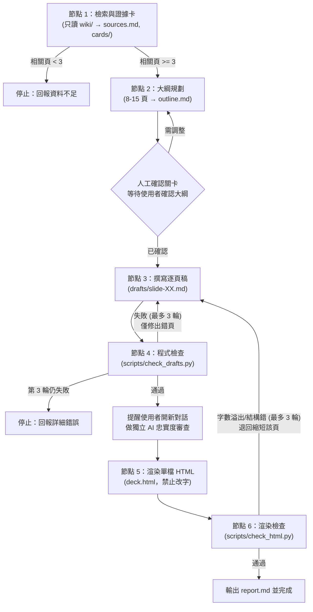

# 主題簡報生成 Graph Workflow（`/topic-slides <主題>`）

本工作流將 `wiki/` 中的登山計劃書、領隊實務與避坑檢討知識，透過 **6 節點具退回機制（Graph）** 的嚴謹流程，轉化為可離線開啟的單一檔案互動式 HTML 簡報（`deck.html`）。

> [!IMPORTANT]
> **最高原則**：
> 1. **禁止讀取 `raw/`**：本流程所有素材一律僅能讀取已脫敏且交叉檢核過的 `wiki/`。
> 2. **安全與忠實優先**：不得憑空捏造數據；跨年份矛盾必標日期並陳；個資零容忍。
> 3. **禁止硬塞版面**：渲染階段嚴格禁止更動逐頁稿文字；若 HTML 檢查發現單頁字數溢出，必須退回節點 3 精簡逐頁稿。

---

## 流程圖與產物目錄



所有中間產物與最終成果統一存放於 `slides/<topic-slug>/`（`<topic-slug>` 使用全小寫英文／拼音 kebab-case，例：`slides/winter-safety-and-gear/`）：

```text
slides/<topic-slug>/
├── sources.md          # 節點 1：相關 wiki/ 檔案清單與摘要
├── cards/              # 節點 1：結構化證據卡（card-01.md, card-02.md...）
├── outline.md          # 節點 2：8-15 頁大綱與每頁對應 cards
├── drafts/             # 節點 3：逐頁稿（slide-01.md ~ slide-XX.md）
├── deck.html           # 節點 5：單一檔案互動式 HTML 簡報
└── report.md           # 節點 6：每輪檢查結果、退回次數與最終交付報告
```

---

## 執行規範（6 個節點）

### 節點 1：檢索與證據卡（只讀 `wiki/`）
1. **嚴禁讀取 `raw/`**：先閱讀 `wiki/index.md`，再挑選與 `<主題>` 相關的 `wiki/trips/`、`wiki/guides/`、`wiki/lessons/`、`wiki/templates/` 頁面深入閱讀。
2. **資料量門檻檢查（硬停止）**：
   - 統計高度相關之 `wiki/` 頁面數量（不含 `index.md`、`log.md`）。
   - **若少於 3 頁，立刻停止流程**，向使用者回報「資料不足」，列出目前找到的頁面與建議先補齊或 Ingest 哪些素材，**不得建立後續大綱或簡報**。
3. **產出檔案**：
   - 建立 `slides/<topic-slug>/sources.md`：列出所有檢索到的 `wiki/...md` 路徑、頁面類型、涵蓋日期與一兩行核心摘要。
   - 建立 `slides/<topic-slug>/cards/card-01.md`、`card-02.md`...：每張證據卡聚焦單一知識點／案例／數據，內容必須包含：
     - 證據標題與分類（實務規範／踩坑案例／數據對照／安全警示）
     - 精確事實與數據（保留原 `wiki/` 中的來源出處與日期）
     - `wiki/` 來源路徑（例如 `wiki/trips/2025-12-daba-four-peaks.md`）
     - 若有跨年份／跨隊伍矛盾（如水源、營地、路況），完整並陳雙方日期與說法，並註記「以最新紀錄優先參考，行前仍須查核最新山況」。

---

### 節點 2：大綱規劃與人工確認（Human-in-the-Loop）
1. 依 `cards/` 規劃 **8–15 頁**簡報大綱，輸出至 `slides/<topic-slug>/outline.md`。
2. `outline.md` 每頁必須清楚標明：
   - 頁碼與檔名（`slide-01` ~ `slide-XX`）
   - 頁面標題與類型（封面／核心觀念／案例拆解／數據對照／安全警示／檢核清單／總結）
   - 本頁核心主張（1–2 句）
   - **對應卡片清單**（例如：`cards/card-01.md`, `cards/card-04.md`）
3. **強制停下來等人工確認**：
   - 將 `outline.md` 頁次與架構摘要呈現給使用者，請使用者審閱頁數、順序與涵蓋重點。
   - **在使用者明確確認大綱前，嚴禁進入節點 3**；若使用者要求調整，先修改 `outline.md` 並再次確認。

---

### 節點 3：撰寫逐頁稿（`drafts/slide-XX.md`）
1. 依已確認的 `outline.md`，逐頁建立 `slides/<topic-slug>/drafts/slide-01.md` 至 `slide-XX.md`（兩位數補零）。
2. **撰寫鐵則**：
   - **僅限引用對應卡片**：每頁只能使用 `outline.md` 指派給該頁的 `cards/` 內容，不得跨卡偷渡或憑空腦補數字。
   - **強制來源出處**：每頁底部必須保留固定來源區，附上確切的 `wiki/` 相對路徑（如 `來源：wiki/guides/trip-planning-sop.md、wiki/trips/2025-12-daba-four-peaks.md`），且不可引用 `raw/` 路徑。
   - **跨年份矛盾必標日期**：若某頁涉及不同隊伍或年份對同一地點（如水源、路況）之矛盾描述，必須標註各自日期並陳，且加註「以最新紀錄優先參考，行前須再查核山況」。
   - **安全警示語法**：關鍵風險或 AI 安全提醒使用標準警示框 `> [!WARNING]` 或 `> [!CAUTION]`，與原始事實清楚區隔。
   - **投影片精簡度**：每頁以重點條列或精簡表格呈現，控制內文純文字在 **350–400 字以內**、項目不超過 10–12 行，避免節點 6 溢出退回。

---

### 節點 4：程式檢查＋獨立審查提醒
1. **執行程式關卡**：
   ```powershell
   python scripts/check_drafts.py slides/<topic-slug>
   ```
2. 程式會嚴格驗證：
   - (a) 頁數介於 **8–15 頁**且檔名連號（`slide-01.md` ~ `slide-XX.md`）。
   - (b) **每頁皆有 `wiki/` 來源引用，且每個引用的 `wiki/...md` 檔案真實存在**（並禁止引用 `raw/` 路徑）。
   - (c) **個資掃描**：不得出現 `09` 開頭手機號、市話、台灣身分證字號、學號、車號、匯款帳號或個人 Email（公共山難專線如 `0800-119-119` 除外）。
   - (d) 若頁面提及「矛盾／衝突／並陳」，須檢核已標註年份／日期。
3. **局部退回機制（最多 3 輪）**：
   - 若 `check_drafts.py` 失敗，記錄該輪錯誤與退回次數，**只退回節點 3 重修報錯的那幾頁**（不得更動已通過頁面），修改後重跑檢查。
   - 若達 **3 輪**仍未通過，立刻停止並將失敗清單回報使用者協助處理。
4. **通過後必發獨立審查提醒**：
   - 檢查通過後，明確向使用者提醒：
     > 「逐頁稿已通過程式檢查！建議你可以**開啟一個全新的對話視窗**，讓沒有本輪脈絡記憶的**獨立 AI** 對照 `slides/<topic-slug>/cards/` 與 `slides/<topic-slug>/drafts/` 進行忠實度審查（確認無幻覺、無超範圍推論、無漏掉安全提醒）。若審查完成或決定直接渲染，請告訴我即可進入節點 5！」
   - 依使用者回覆決定暫停等候獨立審查，或繼續進入節點 5。

---

### 節點 5：渲染單一檔案互動式 HTML（`deck.html`）
1. 將所有已通過的 `slides/<topic-slug>/drafts/slide-XX.md` 轉換並組裝為單一離線檔案 `slides/<topic-slug>/deck.html`（所有 CSS 與 JavaScript 全數內嵌，不得依賴外部 CDN）。
2. **文字零竄改鐵則**：
   - **嚴格禁止更動逐頁稿的任何文字內容**（不可潤飾、增刪、改寫或偷縮句；標題、內文、表格、警示框與來源文字皆須與 `drafts/slide-XX.md` 逐字一致）。
3. **HTML 結構與互動規格**：
   - 每個頁面使用 `<section class="slide" data-slide="01">` ~ `<section class="slide" data-slide="XX">` 包裹；主體內容放 `.slide-body`，底部來源放 `<footer class="slide-source">`。
   - **鍵盤翻頁**：支援 `ArrowRight` / `ArrowLeft`、`Space`、`Home`、`End` 切換頁面，並附畫面「上一頁／下一頁」按鈕與進度條。
   - **頁碼顯示**：清楚顯示目前頁碼與總頁數（如 `1 / 12`）。
   - **安全警示區塊樣式**：在 `<style>` 定義高對比安全警示樣式（如 `.alert-warning`、`.alert-caution`、`.alert-note`、`.alert-tip`），讓登山安全提醒一目了然。

---

### 節點 6：渲染檢查與最終報告
1. **執行渲染程式關卡**：
   ```powershell
   python scripts/check_html.py slides/<topic-slug>
   ```
2. 程式會嚴格驗證：
   - (a) HTML 結構與開關標籤完整、無外部 CDN 腳本／樣式依賴、具備鍵盤左右鍵翻頁邏輯、頁碼顯示與安全警示樣式。
   - (b) `<section class="slide">` 頁數與 `drafts/slide-*.md` 數量完全一致（8–15 頁）。
   - (c) **單頁字數與版面溢出檢查**：檢查每頁主體文字數（預設上限 450 字）與區塊／條列行數（預設上限 14 塊），確保單頁閱讀舒適不溢出。
   - (d) 最終個資掃描（確認 0 筆外洩）。
3. **溢出退回規則（最多 3 輪）**：
   - 若任何頁面因字數或區塊數過多未通過，**嚴禁硬塞版面或僅靠縮小字體蒙混過關**！
   - 必須**退回節點 3 縮短該頁逐頁稿** → 經節點 4 重跑 `check_drafts.py` → 節點 5 重新渲染 `deck.html` → 節點 6 重跑 `check_html.py`（合計最多退回 3 輪）。
4. **輸出執行報告 `slides/<topic-slug>/report.md`**：
   - 記錄：簡報主題、產生日期、檢索之 `wiki/` 頁數與 `cards/` 數量、總頁數、每輪 `check_drafts.py` 與 `check_html.py` 檢查結果與字數統計、各節點退回次數與修正頁碼、是否完成獨立 AI 忠實度審查，以及 `deck.html` 檔案路徑。
